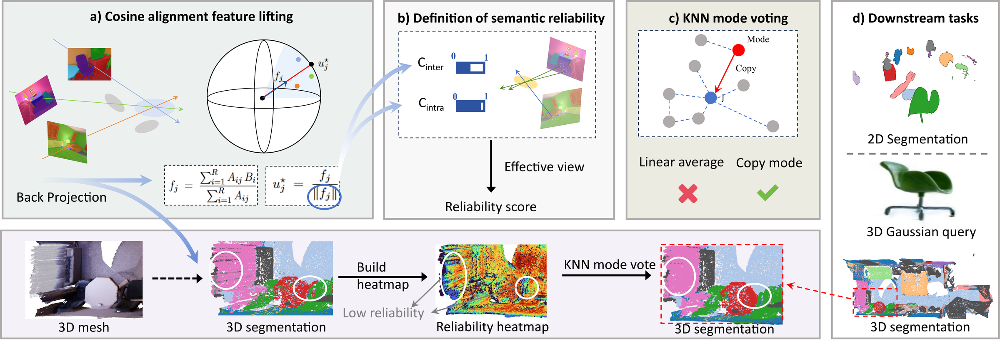

# NormLift

<p align="center">
  <a href="https://arxiv.org/abs/2609.18898"></a>
  <a href="https://neurips.cc/virtual/2026/poster/151918"></a>
  <a href="LICENSE"></a>
</p>

<p align="center">
  
</p>

**NormLift: From Lifted Features To Semantic Reliability In 3D Gaussian Splatting**
Yihan Zang, Da Li, Dominik Engel, Shinkyu Park, Ivan Viola — *NeurIPS 2026*

NormLift lifts 2D CLIP features onto 3D Gaussians **without training** and tells you **which Gaussians to trust**:

- **Lifting as cosine alignment.** Per-Gaussian lifting is posed as a cosine-alignment problem on the CLIP unit sphere; alpha-weighted back-projection followed by ℓ2 normalization is its closed-form solution.
- **Reliability from the norm.** The norm of the back-projected feature factors into intra-view and inter-view consistency. Calibrated by the effective number of views, it becomes a per-Gaussian reliability score `R(j)` — no extra network, no extra rendering pass.
- **Mode voting, not averaging.** Low-reliability Gaussians copy the most-supported neighbor feature instead of averaging neighbors, so refined features stay on the CLIP sphere and the step is class-agnostic.

## Paper

> **NormLift: From Lifted Features To Semantic Reliability In 3D Gaussian Splatting**
> [arXiv:2609.18898](https://arxiv.org/abs/2609.18898) · [NeurIPS 2026](https://neurips.cc/virtual/2026/poster/151918)

If you find this code useful, please consider citing our work (see [Citation](#citation)).

## Quickstart

```sh
export NORMLIFT_DATA=/path/to/data                   # <scene>/ and <scene>_colmap/ live here
export NORMLIFT_OUT=/path/to/outputs                 # per-scene training / lifting / voting outputs
export OPENGAUSSIAN_DIR=/path/to/OpenGaussian        # 3DGS training
export SPLAT_DISTILLER_DIR=/path/to/splat-distiller  # gsplat_ext inverse rendering

# one scene: COLMAP copy -> frozen-point 3DGS -> checkpoint conversion -> feature lifting
python preprocess/convert_to_colmap.py --src $NORMLIFT_DATA/scene0200_00 --dst $NORMLIFT_DATA/scene0200_00_colmap
python train/train_rgb.py --scene scene0200_00
python train/ply_to_pt.py --scene scene0200_00
NORMLIFT_SCENE=scene0200_00 python lift/distill_features.py

# all scenes: reliability -> mode voting -> evaluation
python pipeline/run_pipeline.py --classes 19
python pipeline/run_pipeline.py --classes 15 --steps eval
python pipeline/run_pipeline.py --classes 10 --steps eval
```

## Installation

Tested on Linux with CUDA 12.x, PyTorch 2.x and a single NVIDIA GPU (RTX 4090 / A100 / V100 all work).

NormLift calls two public code bases instead of copying them:

| Dependency | Used for | Install |
|---|---|---|
| [splat-distiller](https://github.com/saliteta/splat-distiller) (Splat Feature Solver, v0.1.0) | `gsplat_ext` inverse rendering, COLMAP dataset loader | `git clone … && cd splat-distiller && pip install .`, then `export SPLAT_DISTILLER_DIR=$PWD` |
| [OpenGaussian](https://github.com/yanmin-wu/OpenGaussian) (commit `1f99db1`) | 3DGS training with frozen initial points (ScanNet protocol) | `git clone … && git checkout 1f99db1`, follow its install, then `export OPENGAUSSIAN_DIR=$PWD` |

Then, in the same environment:

```sh
conda install -c pytorch -c nvidia faiss-gpu -y
pip install plyfile tqdm
```

> **Compiler note.** If the `gsplat_ext` CUDA extension fails to build, make sure `nvcc` matches your PyTorch CUDA version and that the CUDA headers are visible, e.g. `export CUDA_HOME=$CONDA_PREFIX CPATH=$CONDA_PREFIX/targets/x86_64-linux/include:$CPATH`. On Blackwell GPUs set `TORCH_CUDA_ARCH_LIST="8.6;12.0"`.

## Data

We use the 10 ScanNet v2 scenes of the OpenGaussian protocol: `scene0000_00, 0062_00, 0070_00, 0097_00, 0140_00, 0200_00, 0347_00, 0400_00, 0590_00, 0645_00`, in the OpenGaussian layout:

```
$NORMLIFT_DATA/<scene>/
|---points3d.ply                       # scanned point cloud = Gaussian initialization
|---transforms_train.json, transforms_test.json
|---<scene>_vh_clean_2.labels.ply      # ground-truth NYU40 labels, one per point
|---language_features/language_features/
    |---<frame>_s.npy                  # SAM mask ids, 4 granularity levels [4, H, W]
    |---<frame>_f.npy                  # one OpenCLIP ViT-B/16 feature per mask [M, 512]
$NORMLIFT_DATA/<scene>_colmap/         # written by preprocess/convert_to_colmap.py
```

- **Scenes.** Follow the [OpenGaussian](https://github.com/yanmin-wu/OpenGaussian) instructions to obtain the ScanNet scenes with `points3d.ply`, `transforms_*.json` and the `*_vh_clean_2.labels.ply` ground truth.
- **2D features.** Produced by the [LangSplat](https://github.com/minghanqin/LangSplat) preprocessing (`preprocess.py`: SAM ViT-H automatic masks at four granularities, one OpenCLIP ViT-B/16 feature per mask). NormLift uses the `l` level (index 3) and never trains an autoencoder, so the raw 512-d features are used as they are.
- **Text features.** `assets/text_features.json` holds the OpenCLIP text embeddings of the class names and is taken unchanged from OpenGaussian's `assets/text_features.zip`, so that all methods are queried with identical text vectors. Note that this file spells one NYU40 class `showercurtain` while the ScanNet label is `shower curtain`; as in OpenGaussian's own evaluation script, that class therefore has no text vector and is never predicted (the evaluation prints a warning). We keep this behavior for comparability with the published baselines.

## Pipeline

| Step | Script | Output (under `$NORMLIFT_OUT/<scene>/`) |
|---|---|---|
| 0. COLMAP copy | `preprocess/convert_to_colmap.py` | `$NORMLIFT_DATA/<scene>_colmap/` |
| 1. 3DGS with frozen points | `train/train_rgb.py` (OpenGaussian trainer, `--frozen_init_pts`, 30k iterations, `-r 2`) | `point_cloud/iteration_30000/point_cloud.ply` |
| 2. Checkpoint conversion | `train/ply_to_pt.py` | `point_cloud/iteration_30000/point_cloud.pt` |
| 3. Feature lifting | `lift/distill_features.py` — back-projection `f_j = Σ_i A_ij B_i / Σ_i A_ij` (Eq. 3) | `ckpts/point_cloud_features.pt` |
| 4. Visibility & effective views | `pipeline/get_see_count.py`, `pipeline/get_eff_view.py` — `N_eff = (Σ_v W_v)² / Σ_v W_v²` (Eq. 6–7) | `see_count/`, `eff_view/eff_view.pt` |
| 5. Reliability | `pipeline/get_confidence.py` — `R = ‖f‖ · N_eff / (N_eff + β)` (Eq. 8) | `confidence/confidence.pt` |
| 6. Mode voting | `pipeline/knn_vote.py` — support score and conservative replacement (Eq. 9–10) | `knn_vote/voted_features.pt` |
| 7. Evaluation | `pipeline/eval_scannet.py` — 1:1 Gaussian-to-point, 19 / 15 / 10 classes | printed mIoU / mAcc |

`pipeline/run_pipeline.py` runs steps 4–7 for a list of scenes (`--scenes`, `--steps`). Voting is class-agnostic and runs once; `--classes 15/10` only re-evaluates the same voted features.

## Citation

```bibtex
@article{zang2026normlift,
  title={NormLift: From Lifted Features To Semantic Reliability In 3D Gaussian Splatting},
  author={Zang, Yihan and Li, Da and Engel, Dominik and Park, Shinkyu and Viola, Ivan},
  journal={arXiv preprint arXiv:2609.18898},
  year={2026}
}
```

## Acknowledgements

This repository builds on [Splat Feature Solver](https://github.com/saliteta/splat-distiller), [OpenGaussian](https://github.com/yanmin-wu/OpenGaussian), [gsplat](https://github.com/nerfstudio-project/gsplat), [LangSplat](https://github.com/minghanqin/LangSplat) and [gaussian-splatting](https://github.com/graphdeco-inria/gaussian-splatting). We thank the authors for releasing their code.
